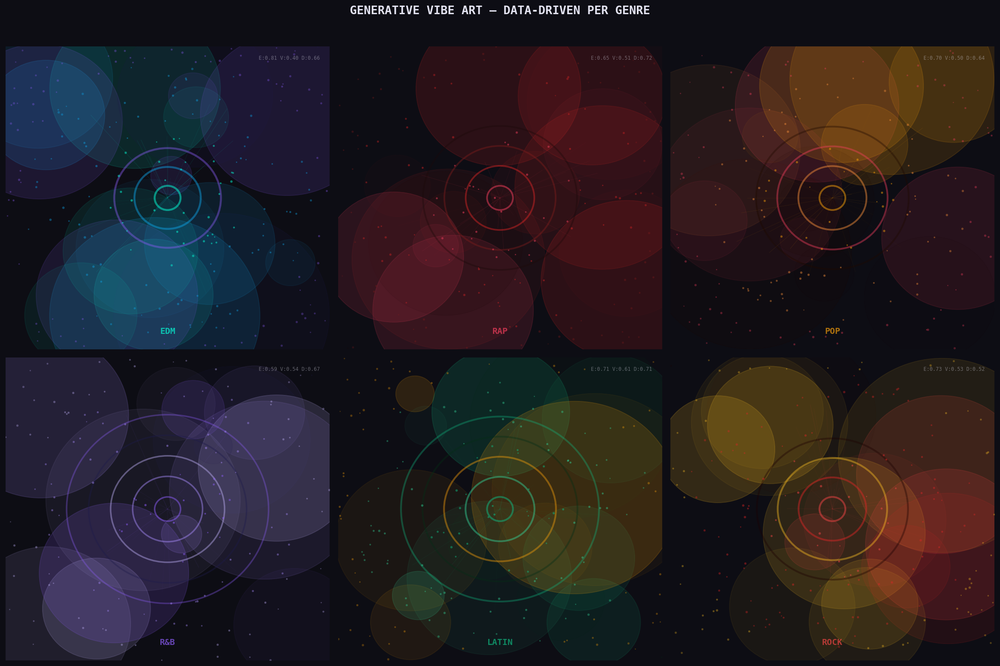
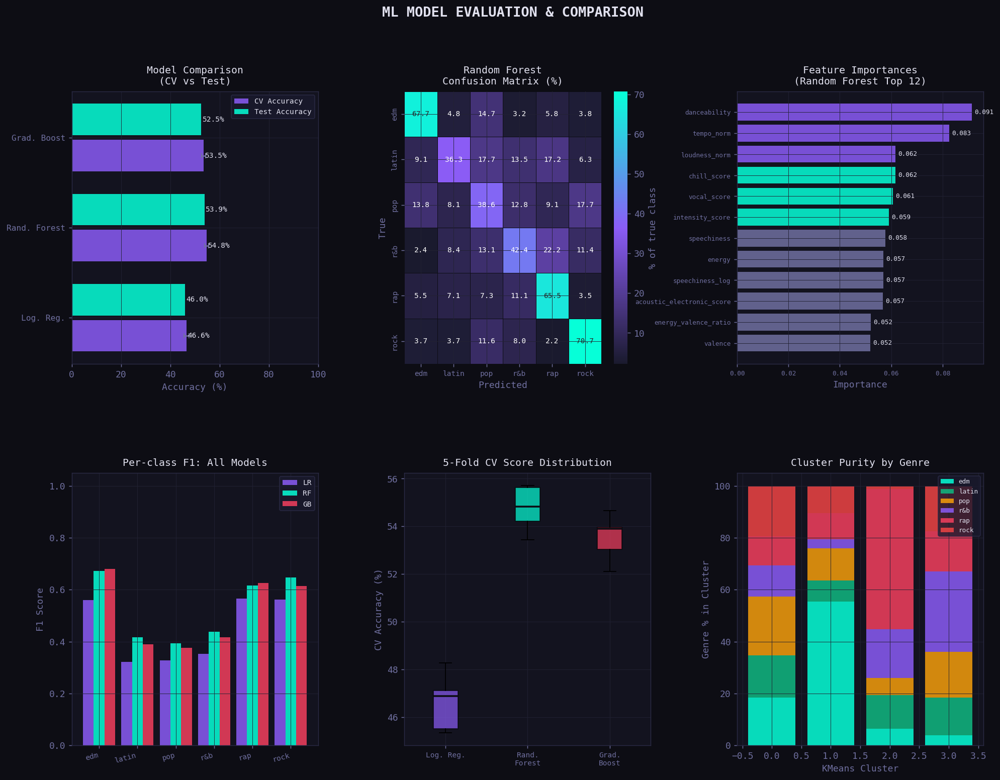

# VibeCanvas 🎵→🎨

**End-to-end data science on 28,351 Spotify tracks:** clean and explore the data, engineer audio features, cluster and classify genres with scikit-learn, then turn each song's audio fingerprint into generative art in the browser.

**[Live demo](https://sharonkodali.github.io/vibecanvas/)**: search any track, or build your own "vibe" with sliders.



## Pipeline

[`src/pipeline.py`](src/pipeline.py) runs every step and writes the charts in `outputs/`.

| Stage | What was done | Result |
| --- | --- | --- |
| Cleaning | Null audit, dedup by `track_id`, duration and range validation, 3×IQR outlier audit | 32,833 → **28,351** tracks; 6,746 extreme values flagged but kept (legitimate in music) |
| EDA | Skewness, correlations, genre balance | 4 strongly right-skewed features; genres balanced (4.1K–5.4K each) |
| Feature engineering | Normalization, log transforms, 5 interaction features (`intensity_score`, `chill_score`, `vocal_score`, …) | 18 model features |
| PCA | Standardize, then fit PCA | 9 components explain 95% of variance |
| KMeans | Elbow method over k = 2–10 | Elbow at **k = 4**, fewer than the 6 labeled genres |
| Classification | Random Forest vs Logistic Regression, stratified 80/20 split + 5-fold CV | **RF 54% accuracy** (LR 46%; random baseline 16.7%) |



**Why 54% is a reasonable result.** Spotify's playlist genres overlap: a pop-EDM crossover is ambiguous even to a human. The unsupervised result agrees, since audio features form 4 natural clusters, not 6. The confusion matrix shows the model is strongest on EDM and rap (the most distinct audio signatures) and weakest between pop and latin.

**Top features (Random Forest importance):** `danceability` (0.091), `tempo_norm` (0.084), `vocal_score`* (0.063), `loudness_norm` (0.062), `chill_score`* (0.061). *Engineered features rank in the top 5, so they add real signal.

More charts: [cleaning & EDA](outputs/01_cleaning_eda.png) · [feature engineering](outputs/02_feature_engineering.png) · [PCA & clustering](outputs/03_pca_clustering.png)

## Generative art

Every visual layer is driven by an audio feature, and a seeded random generator means the same song always renders the same image.

| Audio feature | Visual effect |
| --- | --- |
| energy | Orb count, particle density |
| valence | Brightness, orb opacity |
| danceability | Geometric shapes, ring complexity |
| tempo | Radial ray density |
| acousticness | Concentric rings |
| instrumentalness | Particle field |
| speechiness | Waveform lines |
| loudness | Central glow |
| genre | Color palette |

The app (plain HTML/CSS/JS + Canvas 2D, no build step) has two pages:
- **Search:** live search across all tracks with genre filters and per-track feature bars.
- **Sandbox:** 9 sliders, mood presets and palettes, redrawn in real time.

## Run it yourself

```bash
pip install -r requirements.txt

# Get the dataset (not committed): Kaggle "30000 Spotify Songs" by joebeachcapital
kaggle datasets download -d joebeachcapital/30000-spotify-songs -p data/ && unzip data/30000-spotify-songs.zip -d data/

python src/pipeline.py          # cleans data, trains models, writes outputs/ and site-data/
python -m http.server           # then open http://localhost:8000
```

## Project structure

```
index.html          # the web app
site-data/          # track features for the app (4 JSON chunks, generated)
src/pipeline.py     # cleaning → EDA → features → PCA/KMeans → classifiers → charts
outputs/            # generated charts
data/               # put spotify_songs.csv here (gitignored)
```

## Data

[30000 Spotify Songs](https://www.kaggle.com/datasets/joebeachcapital/30000-spotify-songs) on Kaggle. Audio features come from the Spotify Web API. Used for educational purposes.
